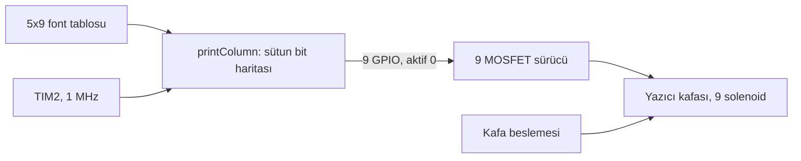

# STM32F407 ile nokta vuruşlu yazıcı kafası sürme

Eski bir 9 iğneli nokta vuruşlu yazıcının kafasını, yazıcının kendi kartı olmadan doğrudan STM32 ile süren deneme yazılımı. Her iğnenin arkasında bir solenoid var. Doğru iğneleri doğru anda kısa bir darbeyle ateşleyince kağıtta harf oluşuyor.

Bu sürümde kafayı taşıyan motor sürülmüyor. Kafa elle kaydırılıyor, yazılım sadece iğneleri sütun sütun ateşliyor. Amaç solenoid sürme devresini ve darbe süresini doğrulamaktı.

## Blok diyagram



## Pinler

| İğne | Pin | | İğne | Pin |
|---|---|---|---|---|
| 1 | PA4 | | 6 | PC3 |
| 2 | PA3 | | 7 | PC2 |
| 3 | PA2 | | 8 | PC1 |
| 4 | PA1 | | 9 | PC0 |
| 5 | PA0 | | | |

Çıkışlar aktif 0: pin 0 olunca solenoid enerjileniyor, 1 olunca bırakıyor. Açılışta bütün pinler 1'e çekiliyor.

Solenoidleri işlemci pini süremez. Her iğne için bir MOSFET ve solenoide paralel ters diyot şart, yoksa bobin kapanırken oluşan gerilim MOSFET'i yakar.

## Nasıl çalışıyor

Her harf 5 sütun ve 9 satırlık bir tabloda tanımlı. Bir sütun 9 bitlik bir sayı, 0. bit 1 numaralı iğneye karşılık geliyor:

```c
{'E', {0b111111111, 0b100100001, 0b100100001, 0b100100001, 0b100000001}},
```

Bir sütun basılırken:

1. Sütundaki 1 olan bitlerin iğneleri aynı anda ateşlenir.
2. `PULSE_WIDTH_US` kadar (1000 µs) beklenir.
3. Bütün iğneler bırakılır.
4. `COL_DELAY_MS` kadar (50 ms) beklenir. Kafa bu sürede bir sütun kaydırılır.

Darbe süresi TIM2 ile mikrosaniye hassasiyetinde sayılıyor. Süre kısa olursa iğne kağıda ulaşmıyor, uzun olursa bobin ısınıyor. Doğru değer kafadan kafaya değişir, kafanın datasheet'indeki darbe süresi ve besleme gerilimine göre ayarla.

Yazılım açılışta 3 saniye bekliyor (kafayı satır başına almak için), sonra `printText` içindeki metni basıp 5 saniye sonra tekrarlıyor.

## Font

Tabloda şimdilik sadece denemede kullandığım harfler var: M, E, R, H, A, B, T, I ve boşluk. Yeni harf eklemek için `font` dizisine beş sütunluk bir satır eklemek yeterli. Tabloda olmayan karakter boşluk olarak basılır.

## Eksikler

- Kafa motoru ve kağıt besleme yok, kafa elle kaydırılıyor.
- Solenoidlerin art arda çalışma süresi sınırlanmıyor. Uzun metinlerde kafanın ısınmasına dikkat et.

## Derleme

STM32CubeIDE'de `File > Import > Existing Projects into Workspace` ile klasörü seç. Saat dahili osilatörden 84 MHz.

## Lisans

MIT. `Drivers` klasöründeki STM32 HAL ve CMSIS dosyaları kendi lisanslarıyla gelir.

## Yazar

Gömülü Sistem Mühendisi M. Eyüb Can, [TECH-OHM](https://tech-ohm.com)
