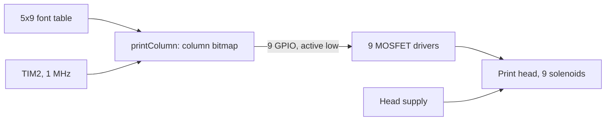

# Driving a 9-pin dot matrix print head

STM32F407 · solenoid pulse timing · 5x9 bitmap font

   [](https://tech-ohm.com)

**English** | [Türkçe](README.tr.md) · An open-source project by [TECH-OHM](https://tech-ohm.com)

Test firmware that drives the head of an old 9-pin dot matrix printer directly from an STM32, without the printer's own board. Behind each pin is a solenoid. Firing the right pins at the right moment with a short pulse forms a character on paper.

This version does not drive the carriage motor. The head is moved by hand and the firmware only fires the pins column by column. The goal was to verify the solenoid drive circuit and the pulse width.

## Block diagram



## Pins

| Pin on head | MCU pin | | Pin on head | MCU pin |
|---|---|---|---|---|
| 1 | PA4 | | 6 | PC3 |
| 2 | PA3 | | 7 | PC2 |
| 3 | PA2 | | 8 | PC1 |
| 4 | PA1 | | 9 | PC0 |
| 5 | PA0 | | | |

Outputs are active low: 0 energizes the solenoid, 1 releases it. All pins are set to 1 at startup.

An MCU pin cannot drive a solenoid. Each pin needs a MOSFET and a flyback diode across the coil. Without the diode, the voltage spike when the coil switches off destroys the MOSFET.

## How it works

Each character is a table of 5 columns by 9 rows. A column is a 9-bit number where bit 0 is pin 1:

```c
{'E', {0b111111111, 0b100100001, 0b100100001, 0b100100001, 0b100000001}},
```

To print one column:

1. The pins whose bits are 1 fire together.
2. The firmware waits `PULSE_WIDTH_US` (1000 µs).
3. All pins are released.
4. It waits `COL_DELAY_MS` (50 ms). The head is moved one column during this time.

The pulse is timed with TIM2 at microsecond resolution. Too short and the pin does not reach the paper, too long and the coil heats up. The right value depends on the head, so set it from the pulse width and supply voltage in the head's datasheet.

At startup the firmware waits 3 seconds (time to bring the head to the start of the line), prints the text in `printText`, and repeats after 5 seconds.

## Font

For now the table has only the letters I used in testing: M, E, R, H, A, B, T, I and space. Adding a letter means adding one five-column row to the `font` array. A character that is not in the table prints as a space.

## Limitations

- No carriage motor and no paper feed. The head is moved by hand.
- Solenoid on-time over a long run is not limited. Watch the head temperature with long text.

## Build

In STM32CubeIDE use `File > Import > Existing Projects into Workspace` and select this folder. The clock is 84 MHz from the internal oscillator.

## License

MIT. The STM32 HAL and CMSIS files under `Drivers` keep their own licenses.

## Author

M. Eyüb Can, embedded systems engineer and founder of [TECH-OHM](https://tech-ohm.com)

## About TECH-OHM

[TECH-OHM](https://tech-ohm.com) designs electronic boards and embedded software, from the first schematic to series production. We also run a 12-month embedded systems training program and consult for engineering teams.

Web: [tech-ohm.com](https://tech-ohm.com) · Email: info@tech-ohm.com
